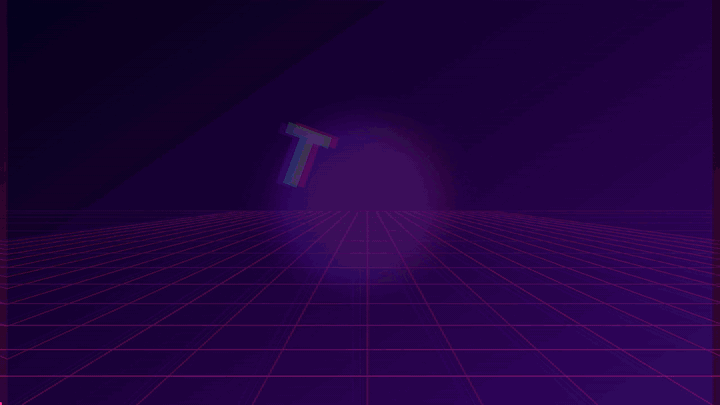
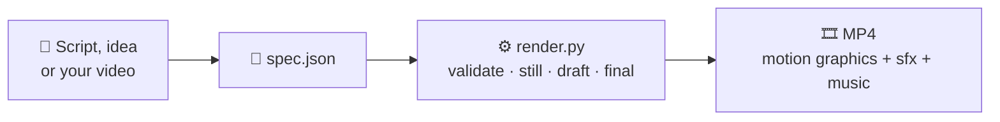
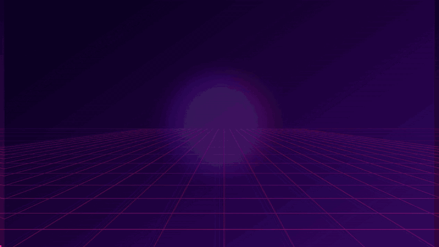

<div align="center">

# 🎬 Motion Video Editor

### Edit or make **text-based videos** from a tiny JSON file — After-Effects-style motion graphics, powered by Python + FFmpeg.


<br>



<sub>The video above was made with this tool, from one JSON file: [`demo/specs/ahmii_labs_text_video.json`](demo/specs/ahmii_labs_text_video.json)</sub>

<br>

**[▶ Watch the full 2K video](demo/videos/ahmii_labs_text_video_2k.mp4)** · **[⚡ Quick start](#-quick-start)** · **[✨ Features](#-features)** · **[🖼 More demos](#-demo-gallery)**

</div>

---

## 💡 What is this?

Motion Video Editor turns a small **spec** (a JSON file) into a finished **MP4** with kinetic typography, glow, glitch, camera moves, transitions, particles and auto sound design. You describe the scenes — the renderer does the animation.

It works in two modes:

| Mode | You give it | You get |
|---|---|---|
| ✂️ **EDIT** | An existing video (`input_video`) | Your footage with animated titles, lower thirds, captions (`.srt`), stats, charts, color grade and music on top |
| 🪄 **CREATE** | A script, bullet notes or an idea | A faceless promo / reel / short / explainer / logo sting on animated backgrounds, with optional voice-over |



---

## ✨ Features

| | |
|---|---|
| 🔤 **Kinetic typography** | 21 text animation presets (tracking, scatter, glitch, mask_up, elastic, drop, spin_in…), per-letter or per-word, with highlight colors |
| 🧩 **Motion layers** | Free composition: text, counters, shapes, images, particles, parenting (null objects), keyframes, easing curves and expressions |
| 🎛 **15 effects** | glow, rgb_split, glitch, shake, grain, vignette, scanlines, flash, light_leak, zoom_punch… |
| 🎥 **Camera** | push_in, pull_out, pan, drift, handheld, dutch, tilt |
| 🔀 **13 transitions** | whip, zoom, spin, circle, barn, flash, dip, glitch, blur, pixelate, rgb, push… |
| 🌌 **6 animated backgrounds** | grid (synthwave), aurora, rays, dots, stars, waves |
| 🔊 **Auto sound design** | `"sfx": true` adds whooshes, pops, impacts and risers; music auto-ducks under voice-over |
| 🌍 **Urdu / Hindi / Arabic** | Bundled Nastaliq, Naskh and Devanagari fonts with correct letter shaping |
| 📐 **Any size** | 720p · 1080p · 1440p (2K) · 2160p (4K), any aspect ratio (16:9, 9:16, 1:1, 4:5, 21:9…) |
| 🛡 **Safe & friendly** | Built-in `--validate` lint with "did you mean…?" hints, sandboxed expressions, auto-fit text |

**15 scene types:** `title` `text` `bullets` `quote` `stat` `chart` `steps` `outro` `lower_third` `caption` `image` · `kinetic` `logo_reveal` `ring` `motion`

**9 built-in themes:** `neon` `clean` `sunset` `mono` `forest` `gold` `cyber` `ocean` `rose` — or define your own colors.

---

## 🖼 Demo gallery

<table>
<tr>
<td width="50%" align="center">
<br>
<b>Text In → Video Out</b> · 13 s · 2K<br>
6 fast cuts, terminal typewriter, EDIT/MAKE cards, logo reveal<br>
<a href="demo/videos/ahmii_labs_text_video_2k.mp4">▶ MP4</a> · <a href="demo/specs/ahmii_labs_text_video.json">spec.json</a>
</td>
<td width="50%" align="center">
<br>
<b>Cyber intro</b> · 10 s · 2K<br>
Glitch title, kinetic lines, count-up stats, logo<br>
<a href="demo/videos/ahmii_labs_cyber_2k.mp4">▶ MP4</a> · <a href="demo/specs/ahmii_labs_cyber_10s.json">spec.json</a>
</td>
</tr>
</table>

Both demos use the same look: cyber purple + neon pink/cyan, synthwave grid, push-in camera, grain + vignette, auto sfx, 30 fps, no voice-over.

---

## ⚡ Quick start

**1. Install FFmpeg** (the only non-Python requirement)

| OS | Command |
|---|---|
| Windows | `winget install Gyan.FFmpeg` (then reopen the terminal) |
| macOS | `brew install ffmpeg` |
| Ubuntu / Debian | `sudo apt install ffmpeg` |

**2. Install the Python packages**

```bash
pip install -r requirements.txt
```

**3. Check that everything works**

```bash
python scripts/render.py --doctor
```

**4. Make your first video** (6 seconds, ~20 s to render)

```bash
python scripts/render.py demo/specs/hello_world.json
```

The result is saved to `demo/videos/hello_world.mp4`.

**5. Or turn plain text into a video**

```bash
# write your idea in script.txt, then:
python scripts/script_to_spec.py script.txt -o spec.json --aspect 9:16 --theme cyber --style kinetic
python scripts/render.py spec.json
```

> 💡 Edit mode example: put `"input_video": "my_clip.mp4"` in the spec and add scenes with a `start` time (seconds). See [`assets/example_edit_video.json`](assets/example_edit_video.json).

---

## 🧾 What a spec looks like

This is the whole `hello_world.json` — two scenes, about 20 lines:

```json
{
  "output": "../videos/hello_world.mp4",
  "aspect": "16:9",
  "resolution": 720,
  "theme": "cyber",
  "bg_style": "grid",
  "sfx": true,
  "fx": [{"type": "vignette"}, {"type": "grain"}],
  "scenes": [
    {"type": "kinetic", "text": "HELLO WORLD", "preset": "tracking", "size": 110,
     "highlight": ["WORLD"], "duration": 2.5,
     "fx": [{"type": "glow", "amount": 0.8}]},
    {"type": "outro", "text": "Made with Motion Video Editor", "subtext": "by Ahmii Labs",
     "animation": "mask_up", "duration": 3.5, "transition": "whip"}
  ]
}
```

Full field list: [`references/spec.md`](references/spec.md) · Motion engine guide: [`references/motion.md`](references/motion.md) · Recipes: [`references/recipes.md`](references/recipes.md)

---

## 🛠 Commands

```bash
python scripts/render.py --doctor                    # check FFmpeg, fonts, TTS, CPU cores
python scripts/render.py spec.json --validate        # lint the spec (no render)
python scripts/render.py spec.json --estimate        # predict the render time
python scripts/render.py spec.json --still 4.5 -o frame.png   # preview one frame
python scripts/render.py spec.json --preview         # quick draft of the first 12 s
python scripts/render.py spec.json --quality draft   # small + fast, for checking pacing
python scripts/render.py spec.json                   # final render
python scripts/render.py spec.json --resolution 4k   # override the size
```

**Recommended workflow:** `--validate` → `--still` on 2–3 key moments → `--quality draft` → final render.

### Resolution guide

| You want | Use |
|---|---|
| Reels, TikTok, YouTube, Instagram | `1080` (default) |
| Fast / small file | `720` |
| 2K / QHD | `1440` |
| 4K / UHD | `2160` (add `"codec": "h265"` for ~40% smaller files) |

`resolution` is the **short side** in pixels, so it works for any aspect ratio.

---

## 🗂 Project structure

```
ahmii-labs-motion-video-editor/
├── README.md
├── SKILL.md                 # skill description (for Claude skill use)
├── requirements.txt
├── scripts/
│   ├── render.py            # the renderer (validate / still / draft / final)
│   ├── script_to_spec.py    # plain text  →  spec.json
│   ├── tts.py               # optional voice-over (edge-tts / espeak / pyttsx3)
│   └── mve/                 # motion engine: layers, fx, transitions, backgrounds, sfx, fonts…
├── references/              # spec.md · motion.md · recipes.md
├── assets/                  # example specs + bundled fonts (Poppins, Noto Nastaliq/Naskh/Devanagari)
├── tests/smoke_test.py      # self-check
└── demo/
    ├── videos/              # the finished 2K demo videos
    ├── previews/            # GIF previews (used in this README) + poster images
    └── specs/               # the JSON files that produced the demos
```

---

## 🎙 Voice-over (optional)

Add a `narration` line to any scene and a `"tts"` setting:

```json
"tts": {"lang": "ur"}
```

Natural voices need `pip install edge-tts` and an internet connection. Without a working voice engine the render still completes (silent, same timing) and tells you how to fix it. Urdu and Hindi text is detected automatically.

---

## ⚠️ Limits (honest list)

- **2D motion graphics only** — no AI-generated footage, no 3D scenes, no video clips as layers.
- **No speech-to-text** — for captions on your own footage, supply the lines or a `.srt` file.
- **Up to ~5 minutes** per video. For longer or cinematic work, split it into parts.
- **Speed depends on CPU cores.** In our test on a single core, a 13 s video at 2K took about 3.3 minutes; 1080p and `--quality draft` are much faster. Run `--estimate` first.
- Social platforms re-encode to 1080p, so 4K mostly matters for YouTube, TV and archiving.

---

## ✅ Tests

```bash
python tests/smoke_test.py
```

Checks easing and expression safety, font coverage (Latin, Urdu, Hindi), resolution maths, and renders the example specs. Prints `ALL OK` when everything passes.

---

## 🤖 Use as a Claude skill

This repo includes [`SKILL.md`](SKILL.md), so the folder can also be used as a skill: describe the video you want in plain words ("make a 10-second cyber intro for my brand") and Claude writes the spec, previews it and renders it for you. See Anthropic's documentation for how to install skills.

---

## 🙌 Credits

Made with ❤️ by **Ahmii Labs**.

Bundled fonts: [Poppins](https://fonts.google.com/specimen/Poppins) and [Noto](https://fonts.google.com/noto) (Nastaliq Urdu, Naskh Arabic, Sans Devanagari), under the SIL Open Font License — see [`assets/fonts/LICENSE-FONTS.txt`](assets/fonts/LICENSE-FONTS.txt).
